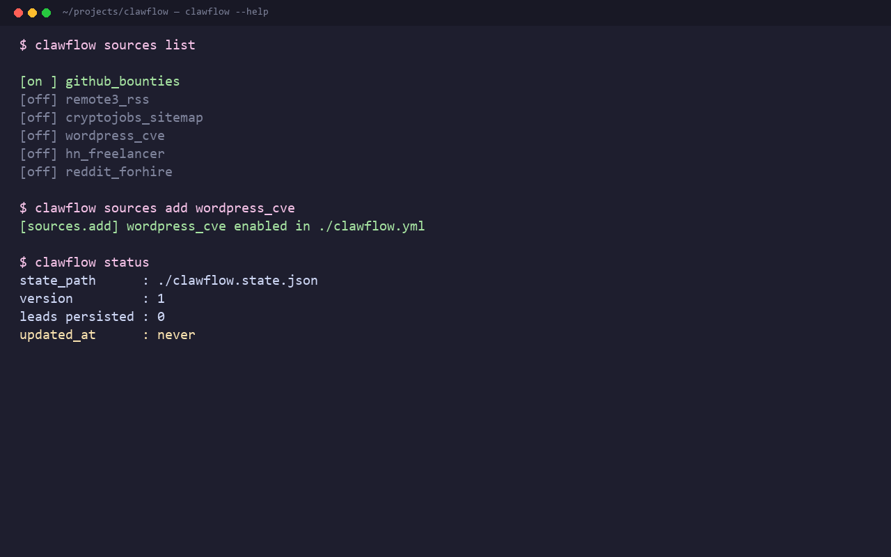

# Clawflow — Launch Kit

> First-week launch script. Pick 2-3 of these; don't blast all of them.

---

## The 30-second pitch (memorize this)

> "Six months ago I was filtering web3.career, Reddit r/forhire, GitHub
> bounties, and WordPress plugin vulnerability feeds by hand across
> six browser tabs. I built clawflow as one binary that does all four —
> pulls jobs, leads, bounties, and CVE-driven outreach opportunities into
> one daily digest. Free, MIT-licensed, runs locally, no SaaS."

---

## Pre-launch — 24 hours before

### Pick a launch day

- **Tuesday, Wednesday, or Thursday** (best GitHub day for HN traction)
- **8-10am US Eastern** if going to HN (peak HN eyeballs)
- **Friday morning US** if going to r/Python (less moderated, more reads)

### Make the demo screenshot



Run `clawflow sources list` (or `clawflow run --once --dry-run`) and grab
the terminal output. Clean formatters, scroll back, screenshot at ~100 cols.
Crop to keep only the "interesting" part — the leads list, not the bootup.

### Make the social preview image

- 1280x640 px PNG
- Black background, mono font
- Two lines:
  ```
  clawflow
  One binary. Four signals. Zero sales-team BS.
  ```
- Subtle small icons: terminal prompt, GitHub, WordPress logo, Solidity diamond
- Save as `social-preview.png`, drop into the repo root before pushing

---

## Post 1 — Hacker News (Show HN)

**Title**: `Show HN: clawflow – One CLI for freelance dev leads (web3 + WordPress)`

**Body**:

```
Hey HN — I built clawflow because I was tired of having six browser tabs
open to find freelance work as a Solidity + WordPress dev.

It pulls from four signal sources:
  • GitHub issues labeled "💎 Bounty" or "bounty" (filters honeypots)
  • Remote3 RSS + CryptoJobsList sitemap (web3 job boards)
  • WPVulnerability.net polls for plugins I support
  • Hacker News "Freelancer" threads + Reddit r/forhire

It runs locally on a 15-minute heartbeat, outputs to console or
Telegram, dedups against a JSON state file, and respects all rate
limits.

Why it's different from tools like Harvey / Instantly / Apollo:
  • No SaaS, no API key, no subscription
  • No cold-email sending — just the upstream signal,
    the part you'd otherwise manually scrape
  • One binary, zero dependencies beyond httpx + feedparser

It's MIT-licensed Python 3.11+. I'd love feedback on the source
architecture — making it pluggable so others can drop in community
sources was the whole point of v0.1.

Repo: https://github.com/<your-org>/clawflow
```

**DO NOT post the link to your personal site. DO post the GitHub link.**

If someone asks "why not use [X competitor]?":
> clawflow is for the person who already has too many SaaS dashboards.
> It's set-and-forget, gives you a daily Telegram digest, and never
> asks for your email list.

---

## Post 2 — r/Python

**Title**: `clawflow — A self-hosted CLI that aggregates freelance dev leads from GitHub bounties, web3 boards, WordPress CVE feeds, and HN/Reddit`

**Body**:

```
Built this for myself and sharing in case it's useful to anyone else
running a freelance dev practice.

What it does:
  - Polls four signal sources (GitHub issue bounties, web3 job board
    sitemaps, WordPress plugin vulnerability feeds, HN/Reddit)
  - Dedups against a JSON state file
  - Alerts via console, Telegram, or email
  - Configured in a single YAML file, runs on cron / Task Scheduler

Stack:
  - Python 3.11+, stdlib + httpx + feedparser + pyyaml
  - Async throughout, source plugins via registry pattern
  - 2000 lines total including docs and tests

The plugin model is open — drop a source.py into the sources dir and it
auto-loads. The README documents the Source protocol.

Happy to answer questions or take feedback.
Repo link.
```

**Pre-empt the obvious question**: Yes, it does respect rate limits (1 req/s
sitemaps, GitHub's documented limits, Reddit's User-Agent requirement).

---

## Post 3 — r/freelance

**Title**: `I built a free CLI that tells me every morning about new bounties + leads for Solidity and WordPress dev — open-source, no SaaS`

**Body** (more personal, less technical):

```
Tl;dr: clawflow — open-source CLI — aggregates GitHub paid bounties,
web3 job boards, WordPress plugin security feeds, and HN/Reddit
freelance threads into one daily Telegram message.

I run a one-person dev shop (blockchain + WordPress). The thing that
took the most time wasn't the dev — it was FINDING the clients.

I was checking:
  - web3.career daily (filtered to "Solidity")
  - GitHub "💎 Bounty" issues (manually)
  - r/forhire (annoying)
  - WordPress.org support forums for plugin complaints (manually)
  - Hn's monthly freelancer thread (manually)

clawflow does all of that. I get one Telegram message a day with
~5-15 ranked leads.

It's MIT, runs locally, and I maintain it because I use it. If it
helps anyone else, great.
```

---

## Post 4 — Twitter / X

A thread, not a tweet:

**Tweet 1/5** (the hook):
> Open-sourced clawflow today — a CLI that does my daily lead-gen for me
> One binary, four signal sources, one Telegram message in the morning
> Repo: github.com/<your-org>/clawflow

**Tweet 2/5** (the problem):
> Before clawflow I'd spend 30 min/day across six tabs:
> - web3.career filtered to Solidity
> - GitHub "💎 Bounty" issues
> - r/forhire new
> - WordPress plugin CVE feeds
> - HN monthly freelancer thread
> All of that, automated, costs me $0/mo

**Tweet 3/5** (the screenshot):
> [paste terminal screenshot]

**Tweet 4/5** (the design choice):
> Why no cold-email sending?
> Tools like Harvey send for you — but then you're a spammer, and
> finding the lead and writing the reply is the part that needs YOU
> clawflow just surfaces what to read, you do the rest

**Tweet 5/5** (CTA):
> MIT-licensed, Python 3.11+, two-line install
> PRs welcome — first community source plugin gets shipped in v0.2
> Repo: github.com/<your-org>/clawflow

---

## Post 5 — Dev.to (cross-post, longer form)

Write a 1000-1500 word "How I built this" article.

**Outline**:
1. The problem (filters 6 tabs a day, hates SaaS)
2. Why I didn't use X / Y / Z (each in 1 paragraph)
3. Architecture overview (one diagram)
4. The first commit (paste 5 lines of git history)
5. What I learned (async source plugins, dedup, JSON store)
6. What's next (community sources, SQLite backend)

Cross-post to Hashnode and Medium for extra reach.

---

## Engagement playbook — first 72 hours

### When someone asks a real question
Answer within 4 hours. Real questions = signal of a real user.

### When someone files an issue
Triage within 24 hours. Even "WONTFIX" is fine; silence isn't.

### When someone submits a PR
Review within 48 hours. Be friendly, be specific. First-time OSS
contributors deserve extra care.

### When someone stars but doesn't engage
Nothing. Stars are a vanity metric. Real engagement (issues, PRs,
discussions) is what matters.

### When someone says "you should add [feature]"
Reply: "Interesting — do you want to drive that as a community source
plugin? I'll happily review a PR."

---

## Tracking — what to watch

### Day 1-7: GitHub stars alone is the wrong metric. Watch:

- Issues opened (good)
- Discussions started (best — community forming)
- PRs opened (great — even typo PRs count)
- Unique cloners per day (check Insights → Traffic → Clones)

### Day 7-30: Watch:

- Stars (now meaningful)
- Forks (someone's actually using it for real work)
- Outside mentions (set up Google Alerts for "clawflow github")

### Day 30-90: Watch:

- Sustained issue + PR rate
- Number of community source plugins
- Anyone using it in production (their LinkedIn/X bios might say so)

---

## If it flops

You launched a tool. It might not hit. That's OK.

The things you still get out of it:

1. A real OSS project on your GitHub profile (recruiters love this)
2. A sales artifact for client work ("I built a CLI used by X people
   to find freelance work")
3. A referenceable starting point for the next iteration
4. Lessons learned for the next launch

Don't burn out trying to make it hit. Ship, learn, iterate.

---

*Last updated for clawflow v0.1.0*
