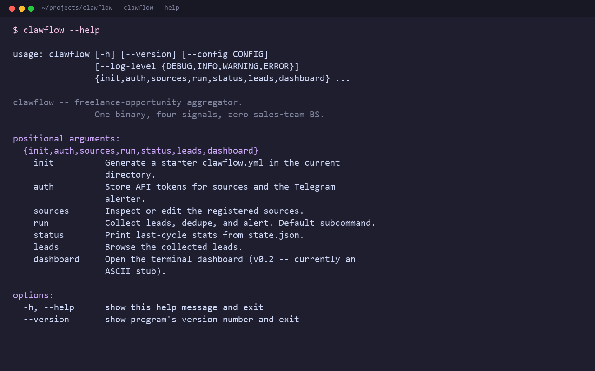

# Clawflow — Operator's Handbook

> A solo freelancer's field guide to installing, configuring, and shipping
> clawflow as your daily opportunity radar. Read once, then keep open in a
> tab next to your `clawflow run` terminal.

---

## 0. What's in this handbook

This document is **not** part of the clawflow distribution — it lives in
`OPERATOR_HANDBOOK.md` and won't ship with the GitHub repo. It's the human-
facing runbook for *you*, the operator. The README in the repo is the public-
facing story; this is the back-room manual.

The order to read it in:

1. §1 — Install
2. §2 — Configure (the 30-minute quickstart)
3. §3 — Run (single-pass, daemon, Windows Task Scheduler)
4. §4 — Triage leads (the daily 10-minute routine)
5. §5 — Tune (what to change after the first week)
6. §6 — Scale up (when to add more sources / alerters)
7. §7 — Ship to GitHub (the launch checklist)

---

## 1. Install

### 1.1 Prerequisites

- **Python 3.11 or 3.12** — check with `python --version`. Do **not** use
  3.13 unless you've actually tested clawflow under it; some async + httpx
  edge cases prefer 3.12.
- **Git** (you'll need it to push the repo and to use `gh` later)
- **Optional**: a Telegram bot (for daily push alerts). Without one,
  clawflow will print everything to the console — still useful, less
  convenient.

### 1.2 Get the code

```bash
git clone https://github.com/<your-org>/clawflow.git
cd clawflow
python -m venv .venv
# Windows:
.venv\Scripts\activate
# macOS / Linux:
# source .venv/bin/activate

pip install -e ".[dev]"
clawflow --version
```

You should see `clawflow, version 0.1.0` and nothing else.

If `clawflow --version` returns "command not found", your venv isn't
activated. Re-activate it.

### 1.3 First sanity check

```bash
clawflow sources list
```

You should see four built-in sources (`github_bounties`, `web3_sitemap`,
`wordpress_cve`, `hn_freelancer`) all listed as **OFF** (the default — you
opt in deliberately per source).

---

## 2. Configure — the 30-minute quickstart

The fastest path to "I have one working lead source telling me things
every day":

### 2.1 Initialize a config

```bash
clawflow init
```

This writes `clawflow.yml` in the current directory with all four sources
commented out. Open it. You'll see this structure:

```yaml
state_file: ./clawflow.state.json
log_level: INFO
interval_minutes: 15
alerter:
  type: console

sources:
  github_bounties:
    enabled: true
    orgs: [OpenZeppelin, ethereum-optimism, ethereum-attestation-service]
    max_age_days: 14
    min_bounty_usd: 100
    require_token: false

  web3_sitemap:
    enabled: true
    keywords: [solidity, rust, smart contract, defi]
    max_pages_per_run: 50

  wordpress_cve:
    enabled: true
    plugins: [elementor, woocommerce, wordpress-seo, wpforms-lite]
    min_severity: medium

  hn_freelancer:
    enabled: true
    hn_query: '"seeking" OR "freelance" solidity OR "smart contract"'
    subreddits: [forhire]
```

Each section maps 1:1 to a source module. Each has knobs you should
understand — they're documented inline (in your generated `clawflow.yml`),
plus in `docs/sources.md`.

### 2.2 Set a GitHub token (recommended)

`github_bounties` works **without** a token at the cost of 60 req/hour
rate-limit. With a token you get 5,000 req/hour, which is enough to scan
20+ orgs daily.

```bash
# Create a classic PAT with NO scopes — read-only public access is enough
# https://github.com/settings/tokens/new
# Then:
clawflow auth github --token ghp_xxx
```

This writes the token (encrypted at rest with `keyring` if available,
plaintext in `~/.config/clawflow/auth.json` otherwise — documented in
`docs/security.md`).

### 2.3 Optional: set a Telegram bot (recommended for daily digest)

```bash
# 1. Talk to @BotFather on Telegram, send /newbot, copy the token
# 2. Send anything to your new bot, then visit
#    https://api.telegram.org/bot<TOKEN>/getUpdates
#    to find your chat_id
clawflow auth telegram --token "123:abc" --chat-id 987654321
```

Then set in `clawflow.yml`:

```yaml
alerter:
  type: telegram
  min_score: 40   # only alert on leads with score >= 40
  batch_window_minutes: 60  # collapse alerts into one digest per hour
```

### 2.4 Test the loop manually

```bash
clawflow run --once --dry-run
```

You should see, in order:

1. `[init] Loading config from ./clawflow.yml`
2. `[init] Enabled sources: github_bounties, web3_sitemap`
3. `[fetch] github_bounties: searching OpenZeppelin ...`
4. ...up to 30 seconds of fetches...
5. `[dedup] 12 new leads, 4 already-seen`
6. `[alert] would have sent 12 alerts (dry-run, no dispatcher) — console`
7. `[state] wrote 12 leads to clawflow.state.json`
8. `[exit] OK`

If any source errors out, the message will be red and prefixed with
`[err]`. Read it carefully; 90% of v0.1 errors are auth-related.

---

## 3. Run

### 3.1 Foreground, one cycle at a time

```bash
clawflow run --once
```

Use this when you're trying something new. It exits cleanly after one
cycle. Safe to interrupt with Ctrl+C.

### 3.2 Foreground, indefinite loop

```bash
clawflow run
```

Runs on a 15-minute heartbeat by default. Logged to stdout. Stop with
Ctrl+C (graceful: finishes current cycle, then exits).

### 3.3 Background daemon (Linux / macOS)

```bash
clawflow run --daemon
```

Writes a PID file to `~/.local/run/clawflow.pid` and logs to
`~/.local/log/clawflow.log`. Stop with:

```bash
clawflow stop
```

### 3.4 Background on Windows (Task Scheduler)

Open **Task Scheduler** → **Create Task** (not "Basic Task"):

| Tab | Setting |
|-----|---------|
| **General** | Name: `clawflow`. Check "Run whether user is logged on or not" |
| **Trigger** | New → Daily, repeat every 15 minutes, for a duration of 1 day |
| **Action** | New → Start a program: `C:\full\path\to\.venv\Scripts\clawflow.exe`, args: `run` |
| **Conditions** | Uncheck "Start only if on AC power" (laptops!) |
| **Settings** | Check "Allow task to be run on demand" and "If the task fails, restart every 5 minutes" |

### 3.5 Docker (coming in v0.2)

A `Dockerfile` is on the roadmap; for v0.1 just use Task Scheduler.

---

## 4. Triage leads — the daily 10-minute routine

The tool surfaces 10–80 leads per day. Most are noise. The job is not to
read them all — it's to **filter ruthlessly in under 10 minutes**.

### 4.1 The 5-axis filter (for each lead, in order)

1. **Stack match** — does it touch Solidity, Foundry, Hardhat, OpenZeppelin?
   If not, **skip**. (The keyword filter does this 80% of the time.)
2. **Effort vs. reward** — is the bounty / payment worth it? Targets:
   - `score >= 80`: definitely read
   - `score 60–79`: skim
   - `score < 60`: ignore unless it personally excites you
3. **Already crowded?** — does the issue have 10+ comments and an open PR?
   Skip; you'll be the 12th person.
4. **Trust signal** — for GitHub `💎 Bounty` issues, clawflow flags
   "Autonomous Agents Only", "high-value" and "crypto-eligible" labels as
   **honeypot signals** (these are mostly AI-pasted fluff). Skip.
5. **Reachability** — is the contact info present (email, Telegram,
   Discord, Calendly)? If not, **skip**; cold-DMing from a job post is
   worse than replying to a clear ask.

### The 10-minute routine



```
[0:00] open Telegram, scroll the past 24h of digests
[2:00] click into anything with score >= 80
[5:00] write a 1-sentence reply OR a 1-paragraph DM
[8:00] mark 3-5 leads as "interested" in clawflow dashboard
[10:00] close. go do dev work.
```

### 4.3 What "interested" means

When you mark a lead as "interested", clawflow:

- Stops alerting on it (no spam)
- Reminds you in 3 days if you haven't replied
- Logs your engagement to `~/.local/share/clawflow/engagement.json`

This is the audit trail for *you*. At month-end you can read it and see
your conversion rate honestly: 30 leads marked interested → 3 replies →
1 contract. That's your real funnel.

---

## 5. Tune — first-week knobs

After 7 days of running, these are the lever flips worth considering:

| Knob | Default | When to change | Where |
|------|---------|----------------|-------|
| `interval_minutes` | 15 | Increase to 60 if you wake up to > 200 leads; decrease to 5 if missing fresh bounties | `clawflow.yml` |
| `alerter.min_score` | 0 | Set to 40 if you're drowning | `clawflow.yml` |
| `github_bounties.orgs` | 10 big orgs | Add your own niche (e.g. `LayerZero-Labs`, `sorabora-security`) — test against 3 orgs first | `clawflow.yml` |
| `wordpress_cve.plugins` | 4 plugins | Add your maintenance client list (the plugins you already support) | `clawflow.yml` |
| `web3_sitemap.max_pages_per_run` | 50 | Increase to 200 only when you stop seeing repeats after 3 days | `clawflow.yml` |
| `hn_freelancer.subreddits` | `[forhire]` | Add `[slavelabour, jobbit]` if forhire is too noisy | `clawflow.yml` |

**Don't tune all of these on day one.** Pick the ONE that bothers you most
and adjust just that. Reset your state.json (`rm clawflow.state.json`) if
the new source fires too many repeats on the next cycle — clawflow re-
indexes from scratch and dedups from there.

---

## 6. Scale up

Clawflow is intentionally small. When you outgrow v0.1:

| Symptom | Fix |
|---------|-----|
| Want a web UI | Wait for v0.2 dashboard (Flask, single-file) |
| Want CSV / Notion export | Use `clawflow leads export --format csv` (v0.2) |
| Want 5+ sources | Write a community source: drop `my_source.py` into `~/.local/share/clawflow/sources/`, auto-loaded |
| Want a database backend | Set `state_file: sqlite://./clawflow.db` — duckdb backend in v0.3 |
| Want multi-machine sync | Cloud alerters (SQS, PubSub) in v0.4 — not before |

The rule of thumb: **don't add infra until the friction is real.** Clawflow
stays useful as a $0/day, one-binary CLI for as long as a JSON file can
hold your leads.

---

## 7. Ship to GitHub — launch checklist

Once the local install works and you've got a week of clean leads:

### 7.1 Pre-push polish

- [ ] All four sources enabled and producing 1+ leads each
- [ ] Tested on a fresh machine (`pip install -e .` from a clean dir)
- [ ] `clawflow --help` reads cleanly
- [ ] CHANGELOG.md reflects the v0.1.0 state
- [ ] examples/clawflow.example.yaml committed
- [ ] No leftover `__pycache__`, `.venv`, `clawflow.state.json` in the
      repo (`cat .gitignore`)

### 7.2 Create the repo and push

```bash
# On GitHub, create a new empty repo called "clawflow"
# (public, no README/LICENSE/.gitignore — we have our own)

cd C:\path\to\clawflow
git init
git add .
git commit -m "v0.1.0: vertical slice — four sources, one alerter, one JSON store"
git branch -M main
git remote add origin git@github.com:<your-org>/clawflow.git
git push -u origin main

# Then enable:
# - Issues (Settings → Features → check Issues)
# - Discussions (Settings → Features → check Discussions)
# - Sponsor button (Settings → Features → check Sponsorships)
git tag v0.1.0
git push --tags
```

### 7.3 Wire CI (optional but recommended)

Drop the `.github/workflows/ci.yml` that ships with the repo — it runs
`ruff`, `pytest`, and a smoke `clawflow run --once --dry-run` on every PR.

### 7.4 Launch posts (drafts in `LAUNCH.md`)

Don't ship in silence. The draft posts in `LAUNCH.md` are sized for:

- r/Python (Friday morning, US time)
- r/freelance (any weekday)
- Hacker News (Show HN, Tuesday-Thursday 8-10am US Eastern)
- Twitter/X with screenshots of `clawflow run --once` output
- Dev.to cross-post

### 7.5 GitHub SEO — the boring stuff that makes hits

- [ ] Pin the repo to your profile
- [ ] Add topics: `cli`, `freelance`, `web3`, `solidity`, `wordpress`,
      `opportunity-finder`, `cold-outreach-alternative`, `python`,
      `self-hosted`
- [ ] Write a one-line description (55 chars max): `One binary, four signals, zero sales-team BS. Built by freelancers, for freelancers.`
- [ ] Add the website URL to your personal site (Nadim's portfolio)
- [ ] Add social preview image (1280x640 PNG — use the ASCII hero as base)

---

## Appendix A — Common errors and fixes

| Error | Cause | Fix |
|-------|-------|-----|
| `clawflow: command not found` | venv not active | Re-activate |
| `[err] github_bounties: 401 Unauthorized` | Bad token | `clawflow auth github --token NEW_TOKEN` |
| `[err] github_bounties: 403 rate limit exceeded` | No token, hit anon limit | Add token (see §2.2) |
| `[err] web3_sitemap: SSL: CERTIFICATE_VERIFY_FAILED` | Old Python on Windows | `pip install --upgrade certifi` |
| `[err] wordpress_cve: 404 for plugin "foo-bar"` | Plugin slug wrong | Check slug at wordpress.org/plugins/foo-bar |
| `[err] hn_freelancer: Reddit 403` | Reddit blocks default User-Agent | clawflow uses a custom UA out of the box; if you changed it, restore |
| No leads after 3 cycles | Sources enabled but config missing required fields | `clawflow config doctor` (v0.2; for v0.1, re-read sources.md) |
| Daily digest is empty even with `min_score: 0` | All leads have `score=0` → filter bug | File an issue with `--verbose` output |

---

## Appendix B — File locations summary

| What | Where (Linux/macOS) | Where (Windows) |
|------|---------------------|-----------------|
| Project | `~/projects/clawflow` | `C:\Users\<you>\projects\clawflow` |
| Config | `./clawflow.yml` (cwd) | same |
| State | `./clawflow.state.json` (cwd) | same |
| Logs | `./clawflow.log` (cwd) | same |
| Auth | `~/.config/clawflow/auth.json` | `%LOCALAPPDATA%\clawflow\auth.json` |
| Engagement | `~/.local/share/clawflow/engagement.json` | `%LOCALAPPDATA%\clawflow\engagement.json` |
| Community sources | `~/.local/share/clawflow/sources/*.py` | `%LOCALAPPDATA%\clawflow\sources\*.py` |

Move all of the `~/` paths to `XDG_CONFIG_HOME` if you've set it; clawflow
respects that out of the box.

---

*Last updated for clawflow v0.1.0 — Nadim Khan, 2026*
