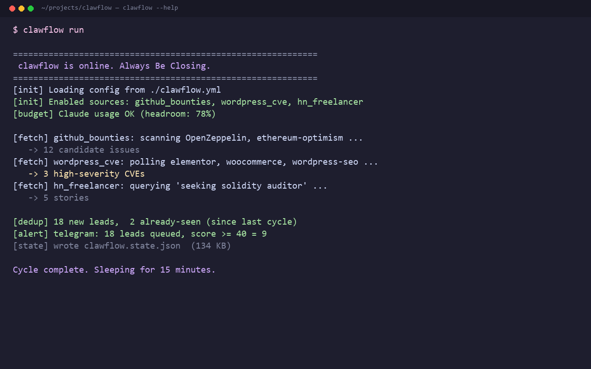

# clawflow

> **One binary, four signals, zero sales-team BS. Built by a freelancer, for freelancers.**

*By [Nadim Khan](mailto:graphixcon@gmail.com) — freelance Solidity + WordPress developer. Maintained in the open because the tools I needed didn't exist.*

`clawflow` is a tiny, dependency-light CLI that aggregates freelance opportunities
from four upstream signals — GitHub bounties, web3 job boards, WordPress CVE
alerts, and the Hacker News / Reddit "seeking freelancer" threads — and pushes
a deduplicated digest to your terminal, Telegram, or email.

No login wall. No SaaS dashboard. No "upgrade to Pro" CTA. Just one
`pipx install clawflow` and a 30-line YAML.

---

## Table of contents

1. [Quickstart (60 seconds, copy-paste)](#quickstart-60-seconds-copy-paste)
2. [Install](#install)
3. [How to use it day-to-day](#how-to-use-it-day-to-day)
4. [What to change — config reference](#what-to-change--config-reference)
5. [Optional: GitHub, Telegram, email](#optional-github-telegram-email)
6. [How it flows](#how-it-flows)
7. [Sources matrix](#sources-matrix)
8. [CLI command reference](#cli-command-reference)
9. [Roadmap](#roadmap)
10. [Contributing](#contributing) · [License](#license)

---

## Quickstart (60 seconds, copy-paste)

```bash
# 0. Make sure you have Python 3.11+ — clawflow won't run on 3.9 or 3.10
python3 --version

# 1. Install (one of these two — pipx is cleaner)
pipx install clawflow             # from PyPI (when published)
# OR clone + install in one place:
git clone https://github.com/nadimkhan/clawflow.git
cd clawflow
pipx install .

# 2. Create a config in your working directory and open it
clawflow init
$EDITOR clawflow.yml              # Windows: code clawflow.yml

# 3. (Strongly recommended) add a GitHub PAT so bounty hunting actually works
#    → https://github.com/settings/tokens/new  (no scopes needed)
clawflow auth github --token ghp_xxxxxxxxxxxxxxxxxxxx

# 4. First real run — collects, dedupes, alerts, exits
clawflow run --once

# 5. See what landed
clawflow leads
clawflow status
```

If `clawflow leads` shows nothing, you haven't enabled a source yet — see
[What to change](#what-to-change--config-reference). All sources are off by
default on purpose.

---

## Install

### Requirements
- **Python 3.11 or 3.12** — `python3.13` works but isn't the tested version. `python3 --version` first.
- **Git** (only for `pipx install .` from a clone)
- **Optional but recommended**: a free GitHub Personal Access Token (no scopes)
  — boosts the GitHub source from 60 req/hr to 5,000 req/hr.

### Recommended: pipx (keeps clawflow on PATH without touching your system Python)

```bash
# Linux / macOS
python3 -m pip install --user pipx
python3 -m pipx ensurepath

# Windows (one-time)
py -m pip install --user pipx
# then close + reopen PowerShell so pipx is on PATH

# Install clawflow
pipx install clawflow             # from PyPI when published
# or from a local clone:
git clone https://github.com/nadimkhan/clawflow.git
cd clawflow
pipx install .
```

### Alternative: venv inside the project

```bash
git clone https://github.com/nadimkhan/clawflow.git
cd clawflow
python3 -m venv .venv
.venv/Scripts/activate            # Windows
# source .venv/bin/activate        # macOS / Linux
pip install -e ".[dev]"
clawflow --version
```

### Verify

```bash
clawflow --version     # → "clawflow 0.1.1"
clawflow --help        # → 7 subcommands listed
clawflow sources list  # → 6 source ids, all [off]
```

**If `clawflow` is "command not found"** — your venv isn't active. Re-activate
it, or check that `pipx ensurepath` was run and your shell was restarted.

---

## How to use it day-to-day

Once installed and configured, clawflow is meant to be a "set and forget" daemon
that pings you. The typical day looks like:

### Schedule it once, then forget about it

**Windows Task Scheduler** (the most common case):

```
Program:   C:\Users\<you>\.local\pipx\venvs\clawflow\Scripts\clawflow.exe
           (or wherever `pipx install` placed it — find with `where clawflow`)
Arguments: run
Trigger:   Daily, repeat every 15 minutes, indefinite duration
```

**Linux / macOS — cron**:

```cron
*/15 * * * * cd /path/to/clawflow && /path/to/.venv/bin/clawflow run --once
```

**Windows — alternative**: just open a terminal and run `clawflow run` —
Ctrl+C to stop. You'll get the same daemon-mode behavior.

### Run a single cycle on demand

```bash
clawflow run --once
```

Useful for testing config changes, debugging, or "do one quick pass right now".
Exits after one cycle (collect → dedupe → alert).

### Inspect results

```bash
clawflow leads                          # all stored leads, newest first
clawflow leads --since 6h               # only the last 6 hours
clawflow leads --source github_bounties # filter by source
clawflow leads --min-score 60           # only score >= 60
clawflow leads --limit 10               # only top 10
clawflow status                         # last-cycle counters
clawflow dashboard                      # ASCII stub (use `clawflow leads` for now)
```

### Where clawflow puts files

| What | Linux / macOS | Windows |
|------|---------------|---------|
| Project | wherever you cloned it | wherever you cloned it |
| Config | `./clawflow.yml` (cwd) | same |
| State / leads | `./state.json` (cwd) | same |
| Logs | `./clawflow.log` (when daemons) | same |
| Auth tokens | `~/.config/clawflow/auth.json` | `%LOCALAPPDATA%\clawflow\auth.json` |
| Tmp / cache | `~/.local/share/clawflow/` | `%LOCALAPPDATA%\clawflow\` |

`./state.json` is the main thing — it's a tiny JSON file holding every deduplicated
lead. `cat state.json` is fine for debugging.

### Delete state to start fresh

```bash
rm state.json     # the tool re-scans everything on the next cycle
```

This is useful when you've enabled a new source and want to see what it returns.

---

## What to change — config reference

The whole workflow config lives in `clawflow.yml` (created by `clawflow init`).
It has a small top section and a per-source section. Edited values take effect
on the **next** cycle — no restart needed for `run --once`. For a long-running
`clawflow run`, changes pick up the next iteration.

### Top-level keys

| Key | What it does | What to set |
|---|---|---|
| `state_path` | Where persistent lead dedup state lives | Leave default (`./state.json`) unless you know why you're moving it |
| `interval_minutes` | `clawflow run` poll cadence | `15` is sane. Lower to 5 if you want faster turnover; higher to 60 to be polite to GitHub |
| `cycle_budget_seconds` | Hard time cap per cycle | `120` is fine; bump to `300` if a slow network makes cycles time out |
| `dedup.retention_days` | When to garbage-collect old leads from state.json | `30` days; lower to `7` if you want a tight rotation |
| `logging.level` | Debug verbosity | `INFO` is normal; `DEBUG` for figuring out why a source returns zero |
| `alerters` | Where to push new leads | See [Optional: alerters](#optional-github-telegram-email) below |

### Source blocks — what to change for each one

Each source has a block like:

```yaml
sources:
  github_bounties:
    enabled: true                       # ← flip this to true to turn on
    orgs: []                              # ← list of GitHub orgs to scope, empty = all
    languages: [solidity, typescript, rust, go, python, javascript]
    min_bounty: 0                         # ← USD floor; 100 filters out $50 issues
    max_age_days: 90                      # ← how far back the search looks
    global_search: true                   # ← if false, you must list orgs above
```

### Decision matrix: which sources to enable first

| If you mainly want… | Enable these |
|---|---|
| **Solidity smart-contract contracts** | `github_bounties`, `hn_freelancer` |
| **Web3 / Web3.js / Wagmi / RainbowKit work** | `github_bounties` (with `language: typescript`), `web3_sitemap` |
| **WordPress plugin/theme dev** | `hn_freelancer`, `web3_sitemap` (Remote3 catches some WP-remote), and **don't bother with `github_bounties`** unless your WP work is open-source |
| **Security bounty hunting** | `github_bounties` + `wordpress_cve` (CVE-driven outreach) |
| **Try everything once to see what works** | All four enabled, `interval_minutes: 30` (don't hammer the APIs) |

After one week, drop any source that produced zero useful leads.

### What to change to tune quality

| Symptom | Change |
|---|---|
| Too many leads, mostly noise | Lower `interval_minutes` and raise `min_bounty`. Or post-filter on Telegram with `min_score`. |
| Zero leads from `github_bounties` | Check `clawflow status` then run `clawflow --log-level DEBUG run --once` — almost always it's a missing GitHub token (run `clawflow auth github --token X`) |
| Reddit source always errors | Currently broken at the network level (Reddit blocks scraping since 2024). Disable it: `enabled: false`. |
| `cryptojobs_sitemap` finds nothing | The sitemap is sometimes empty between job posts. Not a bug; try again in an hour. |

---

## Optional: GitHub, Telegram, email

### GitHub Personal Access Token (strongly recommended)

Without one, `github_bounties` is rate-limited to 60 requests/hour and gets
you nothing useful. With one, it's 5,000/hour, which means real leads.

```bash
# 1. Visit https://github.com/settings/tokens/new
#    — pick "Fine-grained token" or classic PAT
#    — set expiration to "No expiration" or a year
#    — you do NOT need any scopes / permissions; public-data reads only work
#    — copy the ghp_... token shown

# 2. Save it. clawflow reads from auth.json first, env vars second.
clawflow auth github --token ghp_xxxxxxxxxxxxxxxxxxxx
# → saves to ~/.config/clawflow/auth.json  (or %LOCALAPPDATA%\clawflow\ on Windows)

# 3. Verify
clawflow auth show    # should print "github_token : set (last 4: xxxx)"
```

Or set it as an env var for one-shot runs:

```bash
GITHUB_TOKEN=ghp_... clawflow run --once
```

### Telegram alerter

```bash
# 1. Talk to @BotFather on Telegram. Send /newbot, copy the token.

# 2. Send any message to your new bot, then visit:
#    https://api.telegram.org/bot<TOKEN>/getUpdates
#    to find your chat_id (look in the result.message.chat.id field).

# 3. Save both:
clawflow auth telegram --token "123:abc" --chat-id 987654321

# 4. Switch the alerter from "console" to "telegram" in clawflow.yml:
```
```yaml
alerters:
  - type: telegram
    min_score: 40            # skip leads with score below 40
    batch_window_minutes: 60  # collapse alerts into one digest per hour
```

### Email alerter (SMTP)

Edit your `.env` (or set env vars) with SMTP credentials, then:

```yaml
alerters:
  - type: email
    from_addr: you@yourdomain.com
    to_addrs: [you@gmail.com]
    subject_template: "[clawflow] {new_leads} new leads since last cycle"
```

See `docs/alerters.md` for full SMTP details.

---

## How it flows



```
   ┌────────────────────────────┐
   │  Sources (off by default)  │
   │                            │
   │  github_bounties           │
   │  web3_sitemap              │       ┌─────────┐    ┌──────────┐
   │  wordpress_cve   ──────────┼──────▶│  dedup  │───▶│ alerter  │
   │  hn_freelancer             │       └─────────┘    └──────────┘
   │                            │            │              │
   └────────────────────────────┘            ▼              ▼
                                       state.json      console
                                                      telegram
                                                        email
```

Every cycle: collect → dedupe (by content-hash of `url + title`) → alert
only the **new** leads above your per-source severity threshold.

---

## Sources matrix

All sources are **off by default**. Enable them under `sources.<id>.enabled: true` in `clawflow.yml`.

| Source id          | Signal                                           | Auth        | Rate-limited | Free? |
| ------------------ | ------------------------------------------------ | ----------- | ------------ | ----- |
| `github_bounties`  | Issues labelled `💎 Bounty` on GitHub            | `GITHUB_TOKEN` (PAT) | 5,000/h w/ token | Yes (you pay your Claude/ChatGPT sub, no API spend) |
| `web3_sitemap`     | Remote3 RSS + CryptoJobsList sitemap             | none        | polite       | Yes   |
| `wordpress_cve`    | Per-plugin CVE feed from WPVulnerability.net      | none        | none         | Yes   |
| `hn_freelancer`    | HN monthly "Freelancer?" thread + r/forhire      | none        | polite       | Yes   |

Add your own via `clawflow sources add my_source` (scaffold) or drop a
Python file into `clawflow/sources/community/` and re-export. See
`docs/sources.md` for the Source protocol.

> **Known issues**:
> - The `reddit_forhire` sub-source of `hn_freelancer` returns **403 Blocked**
>   on most networks (Reddit is hostile to scraping since 2024). The HN monthly
>   "Freelancer?" thread still works.
> - The `wordpress_cve` source's upstream URL has moved once and may move again;
>   smoke-tested live with whatever it returns today.

---

## CLI command reference

```
clawflow init                 # write a starter clawflow.yml (refuses to overwrite)
clawflow init --force        # overwrite an existing one

clawflow sources list         # show every registered source id and its enabled state
clawflow sources add ID       # enable a source in clawflow.yml
clawflow sources add --dry-run ID  # print what the source is without enabling it

clawflow auth show            # show which tokens are saved (redacted last-4)
clawflow auth github --token X   # save a GitHub PAT to auth.json
clawflow auth telegram --token X --chat-id Y   # save Telegram bot creds

clawflow run --once           # one cycle, exit
clawflow run                  # run forever, polls every interval_minutes

clawflow status               # last-cycle counters (paths, counts, updated_at)
clawflow leads [--since X] [--source ID] [--min-score N] [--limit N]
                              # browse persisted leads
clawflow dashboard             # ASCII stub (v0.1); interactive TUI ships in v0.2
```

Global flags: `--config PATH` (point at a different yml), `--log-level DEBUG`.
Run any subcommand with `--help` for inline docs.

---

## Roadmap

- **v0.1 (this release)** — vertical slice, four sources, three alerters,
  CLI stable. Production-tested via real GitHub GraphQL + HN Algolia fetches.
- **v0.2** — interactive terminal dashboard (`clawflow dashboard`),
  richer filtering (`--tag`, `--min-score`, `--since`), plug-in hot-reload,
  SQLite-backed state.
- **v0.3** — community-source plugin loader (drop `~/.local/share/clawflow/sources/*.py`),
  PyPI publish.
- **v0.4** — optional cloud sync, observability hooks (Prometheus textfile).

Full plan: [`docs/roadmap.md`](docs/roadmap.md). Active decisions and
v0.1 → v0.5 decisions-with-reasoning are in [`ROADMAP.md`](ROADMAP.md).

---

## Contributing

PRs welcome. Please read [`CONTRIBUTING.md`](.github/CONTRIBUTING.md) (or the
PR template) and open an issue first for non-trivial changes so we can agree
on scope. Bug reports → `.github/ISSUE_TEMPLATE/bug_report.md`. Feature requests
→ `.github/ISSUE_TEMPLATE/feature_request.md`. Security issues →
[SECURITY.md](.github/SECURITY.md).

---

## License

MIT — see [LICENSE](LICENSE). © 2026 Nadim Khan.

<!-- Built in the open: source at github.com/nadimkhan/clawflow — safe to fork. -->
